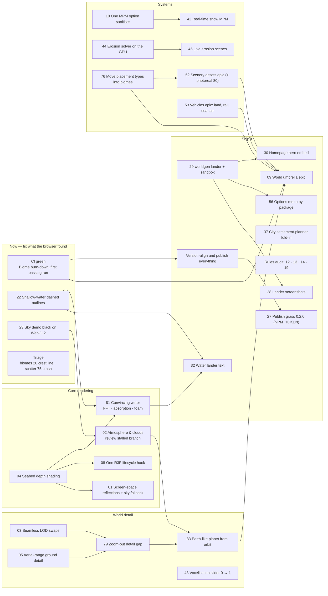

# TODO

Work queue for threejs-worldgen. Every item follows the [package conventions](README.md#package-conventions): fully
parametric, plain three.js first, great but optional React Three Fiber support.

## Planned order

Dependencies between the open tickets; an arrow means the source unblocks the target. A ticket with no arrow is
independent and can run in parallel (in pairs). The tickets themselves are in [.scratch](.scratch/).

The two rendering stories run in parallel: water is `22` and `04` → `81` → `32`, and the sky/planet line is
`23 → 02 → 83`, fed by `03`, `05` and `79`. Systems work (`10 → 42`, `44 → 45`, `76 → 52`) is free-running until it
joins the umbrella epic `09`. The CI gate and version alignment hold the publish lane, not the work.

## In progress: WORLDGEN.md, all phases

- [ ] `threejs-biomes`: seeded 3D noise, climate, height, rivers, volcanoes, 20 blended biomes, ground mix, height
      modifiers, local frames; flat worlds and planets
- [ ] Terrain LOD from orbit to ant scale: cube-sphere quadtree on planets, flat quadtree on planes, skirts, octaves
      skipped below each patch's resolution, Web Worker builds, floating origin, logarithmic depth
- [ ] `threejs-water`: ocean and lakes, noise rivers, flow-accumulation rivers and lakes for bounded maps
- [ ] `threejs-scatter` + `threejs-trees`: blue-noise tiles, instancing, impostors, 22 species, rocks
- [ ] `threejs-city`: settlement placement, tensor-field roads, blocks, lots, buildings, facade shader, flattening
- [ ] `threejs-worldgen`: one `<World>` that composes all of it, biome-driven grass, scale-aware camera
- [ ] Real erosion (GPU hydraulic) for bounded maps

## Living world

- [ ] Parametric scenery assets matched to biomes, with seeded per-instance variety: trees (spruce, oak, apple, palm,
      redwood, …), bushes, plants, fish, asphalt / dirt / gravel / cobblestone roads, sidewalks, mailboxes, power lines,
      street lights, houses, skyscrapers
- [ ] Every asset generates in plausible locations only (fish in water, mailboxes at houses, power lines between
      settlements, orchards near farms, palms on warm coasts)
- [ ] `threejs-vehicles`: animated trains, cars, airplanes, rockets, bicycles, fishing boats, cruise liners, speedboats,
      hovercraft, aircraft carriers, fighter jets on generated road, rail, sea and air networks
- [ ] `threejs-weathering`: rain, snow, wind, lightning; wildfires that spread with fuel, wind and slope and regrow; every
      asset can get wet, snowy, burnt and damaged through a shared material-state layer
- [ ] `threejs-city` settlement planner: population density on a hierarchical hexagonal grid (H3): rural cells, towns
      and urban centres with central-place structure, driving settlements, networks and traffic
- [ ] `threejs-fauna`: fish schools, then birds and wildlife
- [ ] Fuzzy-searchable asset gallery for spawning and placing assets
- [ ] Options menu grouped by package, then by class
- [ ] Rule: generation is never random — seeded and procedural, but looks random (no `Math.random` in generation code)

## Sky and space

- [ ] Day/night cycle driven by planet rotation (sun direction, sky colour, lighting, stars fade in)
- [ ] Lunar cycle: moon orbit gives real phases and moonlight
- [ ] Milky Way band and star field (procedural, correct sidereal rotation)
- [ ] Occasional shooting stars
- [ ] Solar system: Keplerian orbits, planets rendered from the same `World` code at orbital LOD, atmosphere scattering
- [ ] Camera scale from a playable ant to orbital mechanics: altitude-driven near/far planes, LOD tiers
      (micro relief → ground → region → planet → system), floating origin

## Simulation

- [ ] Real-time snow and granular particles with an approximation of the Material Point Method (MPM), sped up by
      neural model reduction: an implicit neural representation (INR) learns a continuous, discretisation-agnostic
      deformation map so dynamics run on a small subset of material points (hyper-reduction). Target: millions of
      points in real time, >20× faster than full-order MPM, <1% position error. Needs offline training per material
      and a WebGPU compute inference path.

## Style

- [ ] Optional voxel slider: one float from 0 (smooth) to 1 (Minecraft-like blocks) that quantises terrain heights,
      snaps mesh vertices and placement to a grid, and switches terrain to block geometry at 1.

## Characters

- [ ] CHARACTERS.md: ragdoll + MoGraph/Mixamo-style animation hybrid (states, triggers, joint limits, motors, crowds)
- [ ] Implement it after the spec is reviewed

## Docs and site

- [ ] Prominent demo links with thumbnails in the docs and READMEs
- [ ] A landing page per package (like threejs-grass's): what it does with pictures, then API docs and a live sandbox
- [ ] Live sandboxes for every package (GUI with every parameter)

## Releases

- [ ] Publish `threejs-grass@0.2.0` once the `NPM_TOKEN` secret (2FA bypass) is set
- [ ] First releases of the new packages
